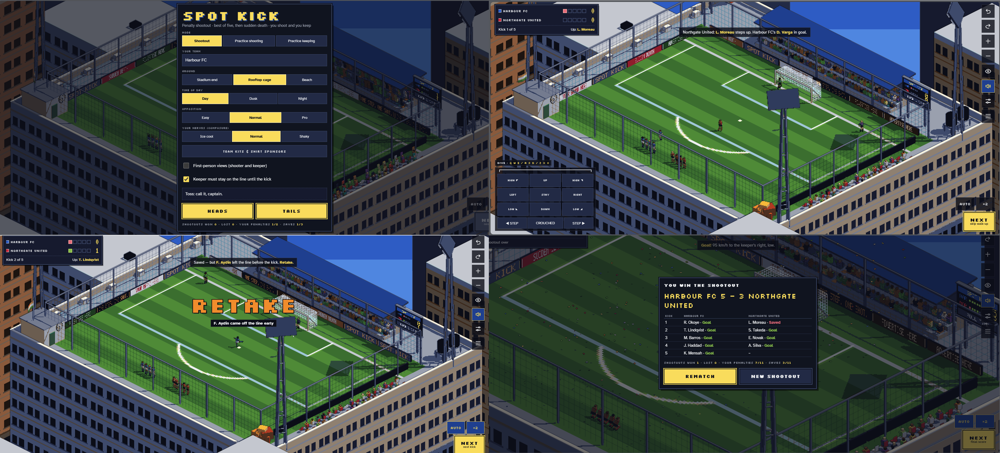

# Spot Kick

**A pixel-art penalty shootout diorama that runs in your browser.**
Take your penalties, keep goal against theirs, and settle it over five kicks each, then sudden death.

▶ **Play it:** `https://ramaditya524.github.io/spotkick/`

<!-- Add a screenshot: save one as screenshot.png in the repo root and uncomment the line below -->
<!--  -->

---

## Features

- **Full shootout rules:** best of five, an early finish once one side can't catch up, then sudden death. In sudden death your keeper takes the sixth kick and the order repeats.
- **You shoot *and* you keep:** you take your team's penalties and save the opponent's.
- **Two-stage kick:** hold to set power before the run-up, then tap as the plant foot lands for a cleaner strike. There are five shot types: placed, driven, chip, curl left and curl right. You can also stutter the run-up.
- **A keeper who reads you:** the AI keeper either guesses early from the taker's body language or waits and reacts. AI takers notice which way you've been diving.
- **Practice modes:** endless shooting or endless keeping, which don't count toward your record.
- **Three grounds:** a stadium end, a rooftop cage in the city, and a beach pitch. Each can be played by day, at dusk or at night under floodlights, and in rain with puddle reflections.
- **Cameras:** over-the-shoulder views for the shooter and the keeper, optional first-person views with drag-to-look, a wide diorama view between kicks, and a replay of every kick.
- **Real ball physics:** drag, spin and curl, bounces that depend on the surface, and a net, posts and crossbar the ball can actually hit.
- **Custom kits:** set shirt, shorts, socks and keeper colours for both teams.
- **Sponsors:** up to six brands rotate round the LED hoardings, one title sponsor sits on the live scoreboard, and each team can have a shirt sponsor.
- **Sound:** a recorded crowd that hushes during the run-up and roars on goals, with separate crowd and effects volume.
- **Works on phones:** the touch controls are laid out for portrait and landscape.

## Controls

### Shooting
| Action | Keyboard / mouse | Touch |
|---|---|---|
| Aim | Drag on the goal, or use the arrow keys | Drag on the goal |
| Set power and start the run-up | Hold **Space**, then release | Hold **POWER**, then release |
| Time the strike (optional) | Tap **Space** as the plant foot lands | Tap **STRIKE** |
| Shot type | **1–5** | Shot buttons |
| Stutter step | **S** | **STUTTER** |

Holding past 80% power risks skying the ball. If you don't tap during the run-up, you get a decent default strike. A well-timed tap is more accurate.

### Keeping
| Action | Keyboard | Touch |
|---|---|---|
| Dive (3 × 3 grid) | **Q W E / A S D / Z X C** | Dive pad |
| Shuffle along the line | **← →** | **STEP** buttons |
| Crouched / upright stance | **U** | Stance button |

With the line rule on, a keeper who leaves the line before the kick and saves it gets the kick retaken.

### Everywhere
| Action | Keyboard / mouse | Touch |
|---|---|---|
| Next / skip | **Enter** or click | **NEXT** or tap |
| First-person view on/off | **V** | Eye button |
| Look around (first-person) | **I J K L**, or drag | Drag |
| Recentre the view | **R** | **RECENTRE** |
| Zoom | Mouse wheel | Pinch |
| Rotate the wide view | Swipe sideways | Swipe sideways |
| Double speed | **X** | **×2** |

## Settings

The sliders button opens the settings for ground, time of day, weather, replays, ordered dither, sound volumes, team kits and sponsors. The start screen lets you choose:
- the mode
- your team name
- the opposition level (easy, normal or pro)
- your composure, which controls how much your aim wobbles under pressure

Settings, kits, sponsors and your win/loss record are saved in your browser's local storage. They stay on that device.

## Deploying to GitHub Pages

The whole game is one self-contained HTML file, with the sounds embedded.

1. Create a new public repository on GitHub.
2. Upload **`index.html`** and this **`README.md`** to the root of the repository.
3. Go to **Settings → Pages**. Under *Build and deployment*, set **Source** to *Deploy from a branch*, choose **`main`** and **`/ (root)`**, then click **Save**.
4. After a minute or two the game is live at `https://<your-username>.github.io/<repo-name>/`.

It needs an internet connection the first time it loads, to fetch three.js from cdnjs and the fonts from Google Fonts. Everything else is inside the file.

## Under the hood

- **Rendering:** [three.js r128](https://threejs.org/), drawn at a low resolution and scaled up with sharp pixel edges.
- **Pixel-art look:** a post-processing pass adds depth and normal outlines and snaps every pixel to a fixed 64-colour palette in OKLab colour space.
- **Simulation:** a fixed 120 Hz step, with ball drag, Magnus-effect curl, spin-aware bounces, and collisions with the posts, net and keeper.
- **Players:** posed every frame with two-bone IK and foot planting, then drawn from instanced primitives in a handful of draw calls.
- **Sound:** the Web Audio API with crowd and effects buses into a compressor. The whistle, net, woodwork and glove sounds are synthesised.
- **No build step and no dependencies to install.**

## Credits

- **Sound effects:** all recorded clips are CC0 (public domain) from [Freesound](https://freesound.org). Credit isn't required, but it's appreciated:
  - Stadium ambience: *by `<freesound-user>`, `<link>`*
  - Goal roar: *by `<freesound-user>`, `<link>`*
  - Goal miss ("ohh"): *by `<freesound-user>`, `<link>`*
  - Pressure: *by `<freesound-user>`, `<link>`*
  - Victory: *by `<freesound-user>`, `<link>`*
  - Ball kick: *by `<freesound-user>`, `<link>`*
- **Fonts:** [Silkscreen](https://fonts.google.com/specimen/Silkscreen), [VT323](https://fonts.google.com/specimen/VT323) and [Atkinson Hyperlegible](https://fonts.google.com/specimen/Atkinson+Hyperlegible) via Google Fonts (SIL Open Font License).
- **3D library:** [three.js](https://github.com/mrdoob/three.js) (MIT License).

## License

<!-- Pick a license for your code, e.g. MIT, and add a LICENSE file. GitHub can add one for you: Add file → Create new file → name it LICENSE → "Choose a license template". -->
Code © `<your name>`, `<year>`. See `LICENSE`.
The sound effects are CC0 and the fonts and three.js keep their own licenses, listed above.
